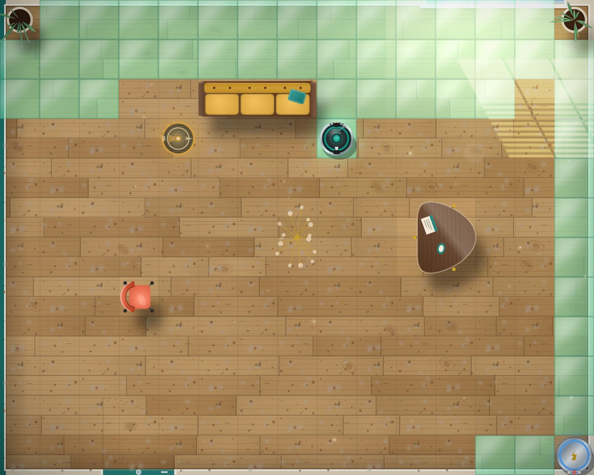
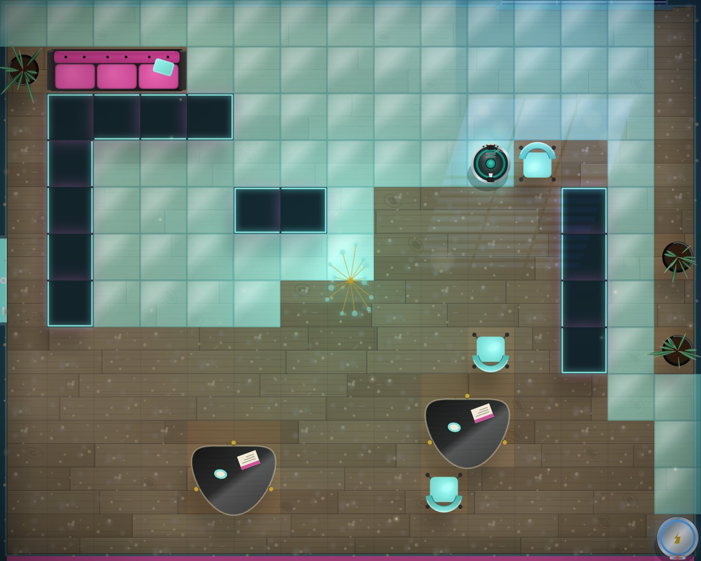
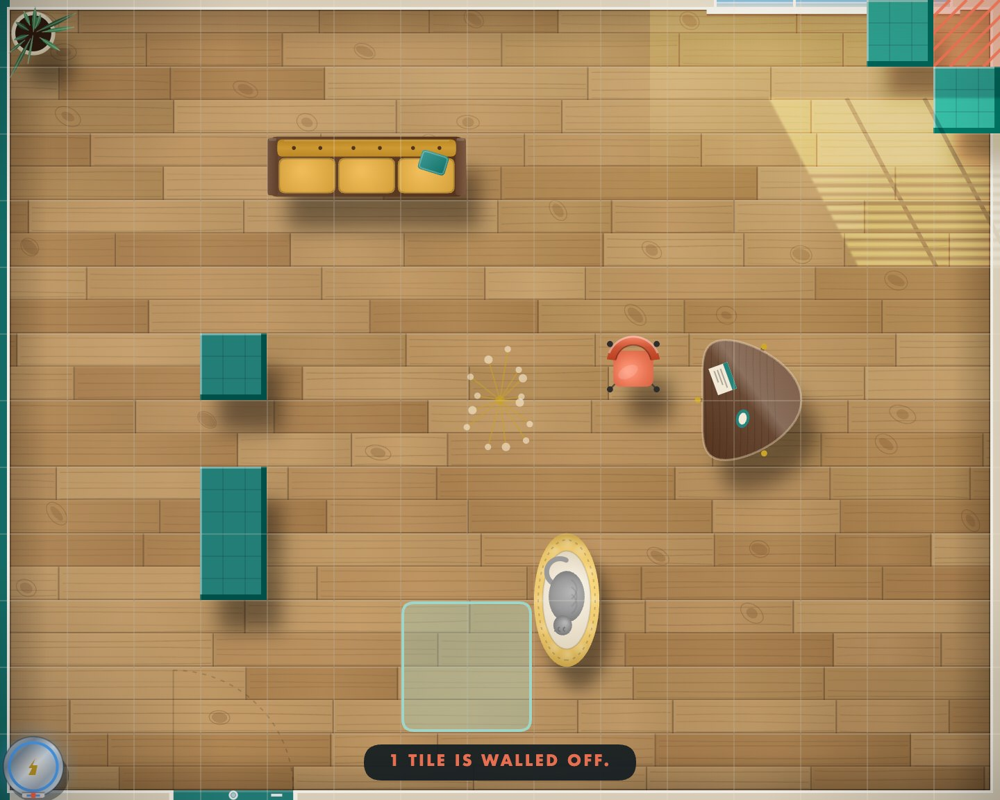
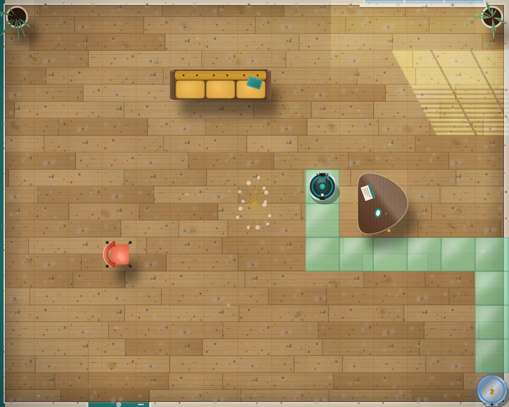
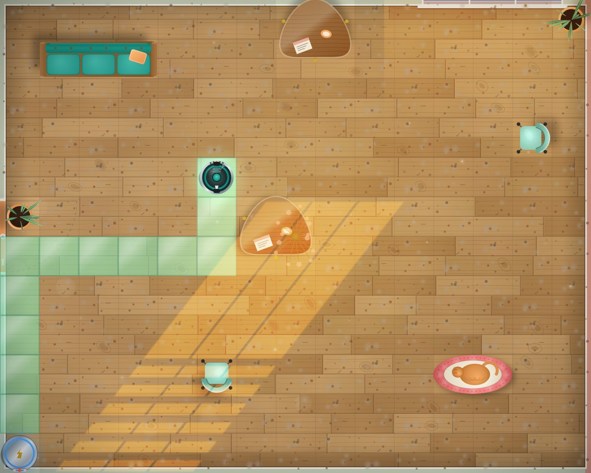
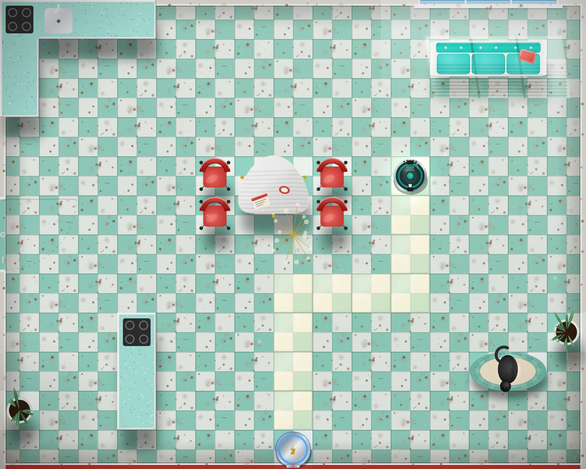
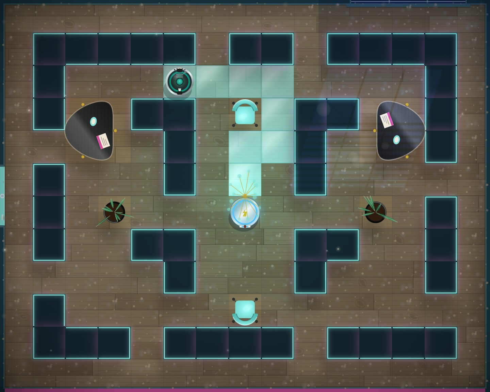
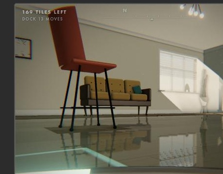
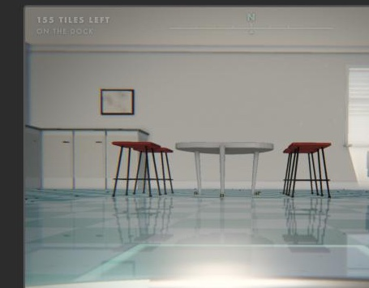

# Roomba Vacuum

A browser game: steer a robot vacuum around a 15×12 room, clean every tile, and get back to the dock before the battery dies. Thirty rooms on the five floors of the house, a new room every day, rooms you build yourself, a par score to beat on each, the ghost of your own best run to race, and a first-person 3D view you can switch to at any time.

No build step, no dependencies. Plain HTML, CSS and canvas.

## Run it

```bash
python3 serve.py 3000
```

Then open http://localhost:3000. Any static file server works (`npm start` runs the same command).

## Controls

| Key | Does |
|---|---|
| Arrows / WASD | Move. Hold to keep going. |
| V | Switch between 2D and 3D. In 3D, left and right turn in place; up and down drive forward and back. |
| Enter | Full screen on / off (Escape also leaves it). The controls move to a side column and the board fills the rest. |
| Drag | In 3D, drag on the board to look around while stopped. The view eases back when you drive. |
| F | Flashlight on / off. |
| R | Restart the level (also restarts its score). |
| Space | Next level once a level is complete; ends the ghost replay. |
| G | Watch the ghost run the par route, at any time. Press V during it to ride along in 3D; Space or G ends it. |
| B | Race my best on / off: the gold ghost of your best run in this room. |
| U | Upgrades panel. Every new star on a level is a point to spend on the vacuum or the charger. |
| M | Mute / unmute. |
| Design button | Colour wheels for the vacuum's lights and its flashlight. |
| H or ? | Help. |

The on-screen d-pad, level buttons and panel buttons do the same things and work on phones.

## Ways to play

The bar at the top of the page picks what to play.

- **The House.** Thirty rooms on five floors, in order. Each floor ends on a harder room, and room 30 is the hardest of all. The picker shows one floor at a time; its arrows browse the others. Stars here earn upgrade points.
- **Room of the Day.** One new room each calendar day, generated from the date, so it is the same room for everyone. The arrows go back through earlier days. There are no streaks and nothing is lost by skipping a day. It keeps a best run and pays no upgrade points.
- **Build a Room.** An editor on the board: place sofas, tables, chairs, plants, pet beds, walls and the dock, pick one of the six themes and a battery difficulty, and play it. The game checks that every tile can be reached and returned from on one charge and marks the tiles that cannot. Rooms save as you build. **Copy link** makes a link that opens the room for someone else, with no server involved: the whole room is in the link. While building, click to place, drag to paint walls or erase, R turns a sofa or pet bed, 1 to 8 pick a tool, Space plays.
- **Race my best.** Finish any room and the run is saved. Next time a gold ghost drives it, one step for each of yours, and the panel says how many tiles ahead or behind you are. It shows in 2D, in the GPU 3D view, and as a dot on the minimap in the Classic 3D view.





## How it is put together

| File | Holds |
|---|---|
| `core.js` | Constants, the obstacle catalogue, the first six levels, and the par solver (BFS plus greedy nearest-tile). No DOM. |
| `rooms.js` | Rooms beyond the house, with no DOM: the piece catalogue, validation, the room code used for saving and share links, dates, the daily generator, the editor's placement rules, and the replay of a recorded run. |
| `game.js` | Game state, level setup, movement rules, input, saved progress, room modes, recorded runs and the best-run ghost, level select, the frame loop. |
| `levels.js` | Rooms 7 to 30, drawn as text maps, and the reader that turns a map into a level. Counts the house. |
| `modes.js` | The bar at the top (The House, Room of the Day, Build a Room, Race my best) and the room editor on the board. |
| `install.js` | The home screen prompt for phones and tablets. |
| `render2d.js` | The top-down view in the atomic-age themes: the furniture painters (sofa, kidney table, shell chair, snake plant, pet bed, counters, crates, neon panels), the chrome dock, the vacuum and its ghost, cleaning effects, overlays, banner and help. |
| `render3d.js` | The first-person view: a software raycaster into an `ImageData` buffer at up to 1.5x the canvas size, with a baked lightmap (window, lamp, dock, ambient occlusion), plaster and brick materials, a real window, see-over furniture, sprites, polished-floor reflections, dust motes, bloom and grade, and the dive transition. |
| `audio.js` | Synthesised sound effects and the motor hum (Web Audio, no files). |
| `upgrades.js` | The upgrade catalogue (efficient motor, bigger battery, solar cells, charging pad, overcharge), points and the Upgrades panel. |
| `design.js` | The Design panel: colour wheels for the vacuum's lights and flashlight, saved settings. |
| `scene2d.js` | The board's theme adapter (sun, shadows, window light, palette; pure and tested) and its cached layers: floor and room shell, furniture with cast shadows, the light; tile dust and polish, reflections on polished tiles, the sleeping cat, dust puffs, bokeh. |
| `serve.py` | A no-cache static server for local play. |
| `tests/run.js` | Headless checks for the level data, the solver, the movement rules, room codes and validation, the daily generator, best runs and room modes. |

The scripts are classic (non-module) scripts that share one global scope; `index.html` loads them in the order above.

Progress (highest level reached, best moves and stars per level, best runs, built rooms), the mute setting and the vacuum design are saved in `localStorage`.

Extra rooms are loaded into one slot after the thirty house levels (`LEVELS[SPECIAL_LEVEL]`), so every renderer draws them from the same level data. The room for a date comes from `generateDailyRoom` in `rooms.js`; changing that function changes every past and future day for everyone, and a test pins one date to catch it.

## Tests

```bash
node tests/run.js
```

## Home screen icon

On a phone or tablet the game offers to put itself on the home screen, where it opens full screen
under its own icon. Android browsers show their install sheet from the **Add it** button; iOS has
no such sheet, so there the bar names the two taps (Share, then Add to Home Screen). The bar shows
once, and the **Home screen** button brings it back. It never appears on a desktop browser or in a
game already opened from its icon.

`manifest.json` and `icons/` are what the phone reads. The icon is drawn in code
(`scripts/icon-art.js`); open `scripts/make-icons.html` through the dev server to redraw and save
the PNGs. There is no service worker, so the icon needs a connection to load the game. On iOS a
home screen game keeps its own saves, separate from the same site in Safari.

## Publishing

The game is live at <https://robot-vacuum-game.netlify.app>, as its own Netlify project.
`scripts/publish-netlify.mjs` uploads only what the page needs: `index.html`, the files it
loads and the vendored three.js. Docs, tests and tools stay behind.

```sh
npm run deploy:check   # list what would ship; no network
npm run deploy         # run the tests, publish, then check every file Netlify serves
```

Publishing needs everything committed and the git-ignored `.env.netlify.local`, which holds
`NETLIFY_AUTH_TOKEN` and `NETLIFY_SITE_ID`. Netlify tokens expire, so an HTTP 401 means it is
time for a new one. The script refuses to publish to any site not named `robot-vacuum-game`.
Room share links carry the site address, so renaming the site breaks links already sent.

## History

Built on Replit in March 2026. Reworked in November 2026 from the assessment in `docs/assessment-2026-11-07.md`; `docs/changes-2026-11-07.md` lists what changed.

## 2D board

The board is the same room as the 3D view, seen from above: each level takes its time of day,
sun, palette, floor and furniture colours from the themes in `scene3d.js`. The sun comes through
the north window and its half-drawn blinds onto the floor, shadows fall away from it (or away from
the Sputnik lamp when the sun is low), polished tiles mirror the lamp and the sky, and the
page's chrome follows the same palette.






## 3D renderer




The first-person view is drawn by a Three.js renderer over WebGL2 (`render3d-gl.js`), styled as a
1950s atomic-age home: six room themes that repeat on every floor, real sunlight through the blinds, glossy floors that
reflect the room as you clean them, depth of field and film grain. Three.js r170 is vendored under
`vendor/three/` and loaded through an import map, so there is still no build step.

The Design panel has a **3D renderer** setting (Modern GPU, or Classic for the original software
raycaster, which also takes over automatically where WebGL2 is missing) and a **Quality** preset
(Low to Ultra) that trades resolution, shadows, ambient occlusion, depth of field and reflections
for speed. The internal resolution also adapts to frame time on its own.

`scene3d.js` describes the rooms as plain data (themes, furniture built from parts, architecture
and decor); `docs/assessment-3d-aaa-2026-11-08.md` is the plan this followed.
