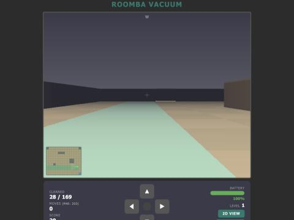
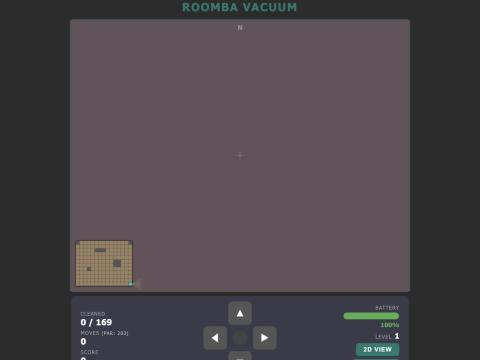
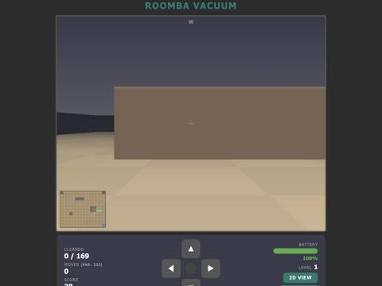
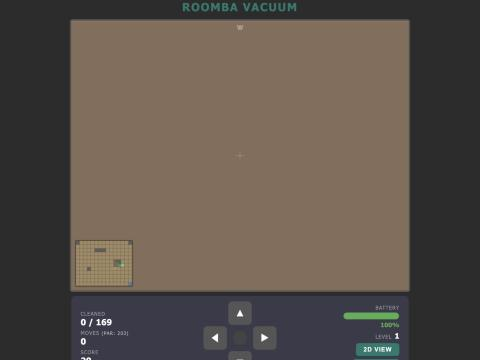
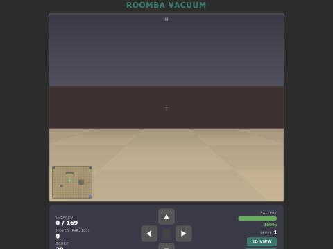
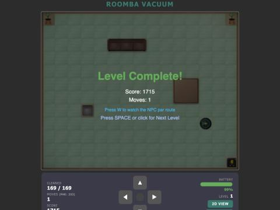
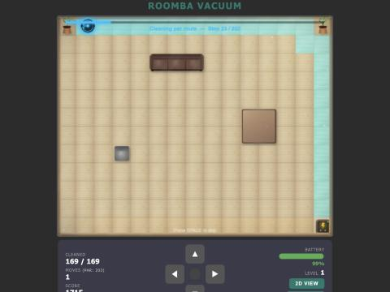
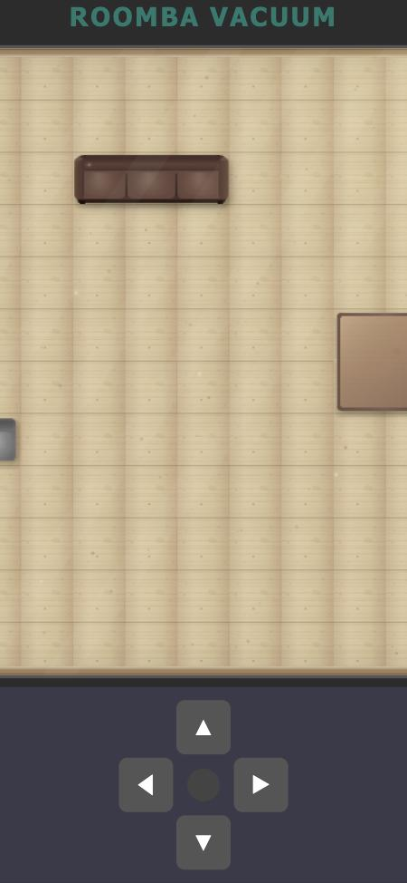
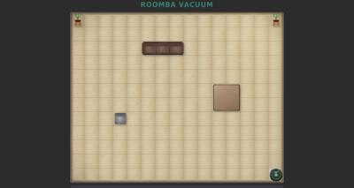
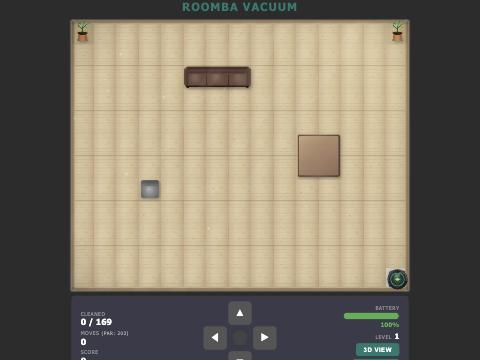

# Ben-VacuumGame: assessment and recommendations

*7 November 2026. Covers the 3D (first-person) mode first, then the game as a whole. The purpose of the game is unchanged: clean every tile, manage the battery, beat par.*

## How this was done

- Read all of `game.js` (3,003 lines), `index.html` and `style.css`.
- Played the game in the built-in browser on a Mac (Chromium, 120 Hz display, 2× pixel density), in both views, across levels 1, 2 and 6.
- Forced specific states from the console (last tile, battery at 1 %, level 6, phone-width viewport) to capture screenshots.
- Each bug below was reproduced in the browser unless it says "from code" (reasoned from the source, not reproduced).

Measurements that matter:

| What | Result |
|---|---|
| Frame rate, 2D and 3D | 120 fps (so the raycaster is not a performance problem on this machine) |
| Quarter turns while holding ◀ for 0.7 s in 3D | 6 |
| Score before / after pressing Restart | 20 / 20, with tiles cleaned reset to 0 |
| Browser pixel ratio vs canvas backing store | 2× vs 1× (720×576), so everything is upscaled and soft |

## The short version

Ten things, in the order I would do them. The first five are small.

1. **Fix the stale camera heading** after Restart and after Next Level in 3D. The compass says N while the view faces the old direction, and the first forward press swings the camera 90°.
2. **Stop holding ◀ or ▶ from spinning the camera** (6 turns in 0.7 s). Turning should not auto-repeat.
3. **Keep the 3D view on screen for Level Complete and Out of Battery.** Both currently snap back to 2D.
4. **Reset the score when a level is restarted.** Today Restart keeps the score and lets you re-earn it.
5. **Make animation time-based, not frame-based.** On a 120 Hz display everything animates twice as fast, including the ghost replay.
6. **Let the player see over furniture in 3D.** A couch or table currently reads as a short wall with "sky" above it. This is the single biggest visual fix.
7. **Give 3D the same warm palette and materials as 2D.** Mauve walls, blue-black fog and a grey ceiling make the 3D room look like a dungeon.
8. **Put the level name, a controls legend and a par comparison on screen.** None of the three exist today.
9. **Make the page fit phones and short windows.** The board is clipped and the stats are off-screen at phone width; the control panel disappears on a 640 px tall window.
10. **Render at native pixel density.** One-line change, visibly sharper everywhere.

---

## Part 1: the 3D mode

### 1.1 What is there today

`renderFirstPerson()` (game.js:2399) is a classic Wolfenstein-style DDA raycaster drawn with canvas `fillRect` calls:

- 360 rays, one per 2 px column, 60° field of view, horizon fixed at mid-screen.
- Each ray stops at the first obstacle tile. Obstacles are drawn as flat-coloured vertical strips with a height factor per furniture type (wall 1.0, plant 0.9, chair 0.65, couch 0.55, table 0.5, pet bed 0.25) and a 3 px lighter line for the top face.
- The floor is cast per 2 px row below each strip, coloured tan (dirty), mint (clean) or pulsing blue (dock), with distance fog.
- Ceiling is a static vertical gradient. Distance fog blends toward a dark blue-grey.
- HUD: a 120×96 px minimap bottom-left with a view cone, a single compass letter at the top at 40 % opacity, a crosshair, a red vignette on bump, and a blue wash while docked.
- Controls become vehicle-relative: ▲ forward, ▼ reverse (keeps facing), ◀ ▶ snap-turn 90°.

The bones are sound: the projection is correct, fisheye is corrected, the DDA is tidy, and the clean/dirty floor reads well up close.

### 1.2 Bugs (reproduced unless noted)

**A. Camera heading is not reset with the level.** `initLevel()` (game.js:476) resets `roomba.dir` to `up` but never touches `fpAngle` or `fpTargetAngle` (declared at game.js:438). Reproduce: enter 3D, turn right, press R, press V. The compass reads N while the view faces E (screenshot below). Press ▲: the Roomba moves north while the camera swings 90°. The same happens on every Next Level if you finished the previous one in 3D. Fix: set both angles from `roomba.dir` in `initLevel()`, and re-sync `fpTargetAngle` from `roomba.dir` whenever the view is toggled.

**B. Holding a turn key spins.** `startHold()` (game.js:673) repeats `handleDirection()` every 120 ms, and in 3D that path rotates 90° each call. Holding ◀ for 0.7 s produced six quarter turns. Fix: in 3D, rotation should fire once per key press (no auto-repeat), or repeat no faster than the turn animation completes (about 350 ms).

**C. Level Complete and Out of Battery snap to 2D.** `render()` (game.js:2914) only draws the first-person view when `gameState === 'PLAYING'`. Finishing a level or running dry in 3D cuts instantly to the top-down board with the overlay on it. Fix: draw the 3D scene underneath the overlays for those states too. The ghost replay can reasonably stay 2D (or become a 3D feature, see 1.5).

**D. Restart button and R key disagree.** R exits 3D before restarting (game.js:734); the on-screen Restart button restarts in place and stays in 3D (game.js:2990). Pick one. Staying in the current view is the less surprising choice.

**E. Reverse duplicates the whole move rule** (from code). `handleFpDirection()` reimplements bounds, obstacles, battery, cleaning, scoring and win/lose checks (game.js:563–599) instead of calling the same code as `handleDirection()` (game.js:601). Any change to movement must be made twice. Fix: one `tryMove(dc, dr)` that both call.

**F. Held keys can get stuck across focus loss** (from code, not reproduced). There is no `blur` or `visibilitychange` listener, so a key released while another window has focus never fires `keyup`, leaving `keysDown` populated and the hold interval running. Fix: on `window.blur`, call `stopHold()` and clear `keysDown`.

### 1.3 Visual problems

**1. You cannot see over furniture.** The DDA stops at the first obstacle regardless of its height (game.js:2488), so a 0.5-high table is drawn as a half-height wall with the ceiling gradient above it. A couch three tiles away becomes a brown band across the screen; a table one tile away fills the whole view with one flat colour. Nothing behind low furniture is ever visible, which also hides dirty tiles that the 2D view shows plainly.

| Table two tiles ahead | Table adjacent | Couch three tiles ahead |
|---|---|---|
|  |  |  |

Fix: keep marching past short obstacles. For each ray, collect every hit (type, distance, side) until a full-height wall or the boundary, then draw them back to front: far wall first, then each shorter obstacle over it. Draw the top face as a real quad between the top edge at the near distance and the top edge at the far side of the tile, rather than a 3 px line. This is the one change that turns the 3D mode from "maze of boxes" into "a room".

**2. Nothing is identifiable.** Every obstacle is a flat-coloured box; a chair, a plant and a wall differ only by height and hue. The 2D view draws cushions, leaves, bricks and a lightning-bolt dock; the 3D view throws that away. Options in rising effort:
- Procedural side textures per type (cushion seams for couch, wood grain for table, slats for chair, bricks for wall), drawn once to small offscreen canvases and sampled per column. This is the standard textured-raycaster step.
- Billboard sprites for plants and chairs instead of boxes.
- A tiny legend on the minimap.

**3. The palette does not match the 2D room.** 2D is warm, sunlit wood with cream walls. 3D has a mauve-grey ceiling, mauve walls (`FP_COLORS.wall` at game.js:2391 is reddish-grey, while the 2D wall tile is dark brick), and fog that pulls everything toward dark blue-grey (`fog` at game.js:2518). The result reads as a basement. Fix: fog toward a warm, light haze (or none; rooms are 15 tiles deep), an off-white ceiling, wall and furniture colours lifted from the 2D palette.

**4. Floor and ceiling are flat.** The floor is flat quads with a faint checkerboard; the ceiling never changes as you move, so half the screen gives no motion cue. Fix: sample the 2D wood plank texture when casting the floor (do the whole frame through `ImageData` rather than per-cell `fillRect`, which also makes 1 px resolution cheap), and cast a simple ceiling the same way so the top half moves with you.

**5. The camera is at human eye height.** The horizon sits at 50 % of the screen, which is a person standing in the room. A Roomba's eye is a few centimetres off the floor. Lowering the eye (horizon around 60–65 % down the screen, with most of each wall's height above it) makes furniture loom and sells the "you are the vacuum" idea. It is a two-line change to how `wallTop` and `wallBot` are computed (game.js:2512).

**6. A wall right in front of you is a blank screen.** Because strips are untextured and the fog is weakest up close, an adjacent wall is one solid colour (see the stale-heading screenshot). A baseboard line and a texture fix this for free once items 2 and 4 are done.

**7. Chunky rendering.** 2 px columns and 2 px floor rows are visible as blocks. At 120 fps there is headroom for 1 px, and the `ImageData` approach makes it essentially free.

**8. HUD is faint and small.** The minimap is 8 px per tile at 70 % opacity in the corner; the compass letter is 14 px at 40 % opacity. There is no battery or tiles-left readout inside the view, so in 3D the only status is the panel below the canvas. Suggest: a larger minimap (or a toggle), a compass strip, a slim in-view battery bar that turns red and pulses under 20 %, and a "tiles left" counter.

**9. The crosshair has no job.** There is nothing to aim at. Replace it with a hint of the Roomba's own front bumper along the bottom edge, which grounds the camera as a vehicle and gives bumps something to shake.

**10. Bump feedback is weak.** A 0.17 s red vignette at 30 % opacity. Add a short camera shake, a slight backward nudge of `drawX/drawY`, and a sound (see 1.5).

### 1.4 Usability of the 3D mode

- **The d-pad lies in 3D.** The buttons still show ◀ ▶ as if they move sideways; in 3D they turn. Relabel them (↶ ↷, or "TURN") whenever `viewMode === 'FP'`.
- **Nobody is told 3D exists.** The only cue is the "3D View" button. Add it to a controls legend (see 2.2) and mention V on the first-level banner.
- **No cue on entering 3D.** The cut is instant. A 150 ms fade, or a quick zoom from the top-down Roomba into its eye, would signal the mode change.
- **Hold-to-move is frantic in 3D.** 120 ms per tile is 8 tiles per second; in first person that is a sprint. Consider 180–200 ms in 3D, or ease the first repeat.
- **Snap turns are right for a grid game.** Keep them; just fix the auto-repeat (bug B) and keep the 0.2 s ease.
- **Frame-rate dependent speed.** All eases (`* 0.3`, `* 0.22`, `* 0.25`), fade increments (`+= 0.035`, `+= 0.05`) and the ghost step timer (`framesPerStep` at game.js:2047) count frames, not milliseconds. On this 120 Hz Mac the replay runs at twice its intended speed and every ease is twice as snappy as on a 60 Hz laptop. Pass the `requestAnimationFrame` timestamp into `render()` and scale by elapsed time.

### 1.5 Worth adding to 3D

- **Sound.** The game is silent. A Web Audio synth (no asset files) can do: motor hum that rises when moving, a soft "tick" per cleaned tile, a thud on bump, a chime on dock, a beep under 20 % battery. Sound does more for a first-person view than any shading.
- **Watch the ghost in 3D.** The par replay is 2D only. Rendering it through the same raycaster from the ghost's position would be a genuinely fun use of the mode.
- **Ground marker.** A subtle highlight on the tile directly ahead tells the player exactly where ▲ will take them.

---

## Part 2: the whole game

### 2.1 Bugs

- **Score survives Restart.** `initLevel()` resets `cleaned` and `moves` but not `score` (game.js:514–520). Restarting a half-finished level keeps the points and lets the same tiles pay out again. Fix: snapshot `score` at level start and restore it on restart.
- **Frame-based timing** (see 1.4). Affects 2D too: the Roomba glide, clean sparkles, tile fade, dust motes, dock pulse and the ghost.
- **Soft rendering on high-density screens.** The canvas is 720×576 backing pixels stretched over 720×576 CSS pixels on a 2× display. Set the backing store to `720 * devicePixelRatio` and `ctx.scale(dpr, dpr)`. Text, grid lines and the Roomba get crisp immediately.
- **Stuck keys on focus loss** (from code; see 1.2 F).

### 2.2 Onboarding and instructions

- **Level names are never shown.** `LEVELS[i].name` exists for all six rooms and is used nowhere; the UI says "Level 1". Show "Level 1: Living Room" as a banner that fades after two seconds and in the panel.
- **No controls legend.** The keys (arrows/WASD, hold to keep moving, V, R, Space, W) are only ever mentioned on the end-of-level overlays. Put a one-line legend under the panel and a "?" overlay for the full list.
- **No statement of the goal.** New players discover the battery rule by dying. One sentence on the first banner: "Clean every tile. Get back to the dock before the battery runs out. Beat par."
- **Par is unexplained** and, being a greedy nearest-tile route (`computeParRoute`, game.js:333), it is beatable. That is fine for a target, but call it "Ghost" or "Target" rather than "par" if you do not want to promise it is optimal.

### 2.3 Feedback and scoring

- **Level Complete does not mention par.** The overlay (game.js:2288) shows score and moves only. Show "Moves 180 · Par 203 · 23 under par", a 1–3 star rating, and the bonus breakdown. This is the moment the par feature pays off and right now it is wasted.
- **The bonus ignores par.** `bonus = max(0, totalDirty*2 - moves) * 5` (game.js:658). Tie the bonus to par instead (for example `max(0, par - moves) * 10` plus a flat completion bonus) so the displayed target and the scoring agree.
- **Low battery is colour-only.** The bar turns yellow then red. Add a pulse, a beep, and a "dock is N moves away" hint when battery ≤ cost × distance + a margin. The BFS to compute that distance already exists (`bfsFromSource`, game.js:230). This helps without changing the rules.
- **No pause.** Add P or Escape.

### 2.4 Flow and progression

- **Nothing is saved.** A reload starts at level 1 with score 0. Store highest level reached, best moves per level and best score in `localStorage`, and add a simple level select.
- **The ghost's "approach" phase is confusing.** It appears in a far corner and drives to the dock for no stated reason ("Approaching start..."). Either start it on the dock, or frame it: "Ghost vac enters the room". It also runs at double speed on 120 Hz displays (frame-based timing).
- **Overlays only mention keys.** On a phone there is no Space or R. The canvas does accept a click for Next Level, but nothing says so; add visible Next Level and Retry buttons on the overlays.

### 2.5 Layout, phones and short windows

- **Fixed 720 px width, scrolling disabled.** `body { overflow: hidden }` (style.css:15) and `#controlPanel { width: 720px }` (style.css:46). At phone width the board is clipped on the right, the stats and battery are off-screen, and nothing can be scrolled into view. On a 640 px tall desktop window the entire control panel is cut off.

| Phone width (375 px) | Desktop window 640 px tall |
|---|---|
|  |  |

Fix: `#gameCanvas { width: min(100vw - 32px, 720px); height: auto }`, let the panel wrap under it, allow vertical scrolling, size the d-pad buttons to at least 56 px for thumbs, add `touch-action: none` on the d-pad so holding a button does not scroll the page, and put the d-pad bottom-right on narrow screens.

### 2.6 Accessibility

- D-pad buttons have no labels; screen readers announce "black up-pointing triangle". Add `aria-label`s.
- The canvas has no text alternative. An `aria-live` status line ("112 of 169 cleaned, battery 64 %") costs little.
- No visible focus styles on the buttons.
- Colour choices are fine: clean mint vs dirty tan is distinguishable, and the battery shows a number as well as a colour.
- Honour `prefers-reduced-motion` for dust motes and pulses.

### 2.7 Visual polish, 2D

The 2D view is the strong half: wood planks, drawn furniture, sunlight, dust, a detailed dock, clean sparkles. Small things:

- The "CLEAN" label on the Roomba is 3.5 px text and never readable. Drop it or make it a dot.
- The canvas has a 6 px rounded border but square content corners, so the corners show the dark border colour.
- "Roomba" is iRobot's trademark. Fine for a home project; rename (Robo Vac, Dust Buster, Suck It Up) before putting it anywhere public.

### 2.8 Code health (brief, because it affects everything above)

- One 3,000-line file. Splitting into `levels.js`, `solver.js`, `render2d.js`, `render3d.js`, `input.js`, `main.js` as ES modules needs no build step and makes the 3D work far easier to iterate on.
- Duplicated movement rule (1.2 E).
- Frame-based timing (1.4).
- Global mutable state is fine at this size, but a single `state` object makes save/load (2.4) trivial.
- No tests. The solver and the movement rules are pure functions once extracted and can be tested headlessly in Node.

---

## Part 3: a suggested order of work

**Tier 1, an evening: bugs and quick wins.** Heading reset (A), no turn auto-repeat (B), 3D under overlays (C), score reset, pixel-density scaling, time-based animation, level-name banner, controls legend, par comparison on Level Complete, blur handler. Each is a few lines.

**Tier 2, a weekend: make 3D look like the 2D room.** See-over raycasting with real top faces, warm palette and fog, textured walls and floor via `ImageData` at 1 px, cast ceiling, lower camera, in-view HUD, d-pad relabel in 3D, responsive layout, saved progress.

**Tier 3, when it is fun to: the extras.** Sprites for plants and chairs, sound, 3D ghost replay, level select, file split and a couple of solver tests.

If you want one thing to do first, do Tier 1 bugs A, B and C together: they are all in the same two functions and they are the three things a player hits within a minute of pressing V.

## What was not checked

- Real touch devices and Safari or Firefox. Phone findings come from a resized Chromium viewport.
- Performance on a low-end machine. 120 fps here does not guarantee 60 fps on an old Chromebook; the `ImageData` rewrite would help there too.
- The stuck-keys-on-blur bug is reasoned from the code, not reproduced.
