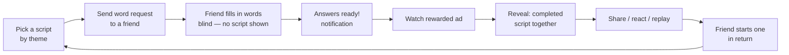

# Peer-to-Peer Mad Libs — Game Design Spec

**Status:** Draft v1 · August 9, 2026
**Source:** Concept pitch captured in Granola ("Peer to peer mad libs idea," Aug 8, 2026)

---

## 1. Concept

A mobile-first social word game built on the classic Mad Libs formula, made two-player and asynchronous:

1. You pick a short script (a "Mad Lib") based on a theme or scenario you want.
2. You send a friend a request to fill in a handful of words — a noun, a verb, an adverb, an adjective — **without them seeing the script**.
3. When their answers come back, you **watch an ad to unlock the reveal**: the completed script with their words dropped in.
4. Your friend can then fire one back at you, and the same ad gate applies before they see your answers.

The business model in one line: **monetizing time, not chance.** There is no wagering, no loot-box randomness, no purchase pressure — the "price" of a laugh is a rewarded ad view, paid by the person who wants the reveal.

### Why it works

- **The blind fill is the comedy engine.** The friend answers honestly (or absurdly) with zero context, which is exactly what makes the completed script funny.
- **Anticipation is the retention engine.** From the moment answers come back, the requester *wants* the reveal — the ad sits precisely at the moment of maximum motivation.
- **Reciprocity is the growth engine.** Every completed round ends with a natural "your turn" prompt, so one invite seeds a back-and-forth loop between two people.

---

## 2. Core Loop



One full round = **two sessions** (requester picks + sends; friend fills) plus **one reveal moment** (ad + payoff). The return round doubles it. A healthy pair of friends generates an ad impression roughly every completed script.

---

## 3. Player Roles & Flows

### 3.1 Requester flow

1. **Browse scripts** — grid of script cards grouped by theme (see §4). Each card shows title, theme, tone rating, and the number of blanks (e.g. "4 words").
2. **Preview** — requester can read the full script with blanks shown (they're the one person who *should* see it).
3. **Pick a recipient** — from in-app friends, contacts, or a share link (see §5).
4. **Send** — the app generates a fill request containing only the word prompts, never the script text.
5. **Wait** — request shows as "Waiting on Alex…" in the requester's inbox. Optional gentle nudge after 24h.
6. **Reveal** — when answers arrive: notification → tap → rewarded ad (15–30s) → animated reveal of the completed script, with the friend's words highlighted.
7. **After the reveal** — react (emoji/laugh meter), share an image card of the script, and a one-tap "Send one back to Alex" that jumps to step 1 with the recipient pre-filled.

### 3.2 Filler (friend) flow

1. Receives a push notification or share link: "Ben wants 4 words from you 👀".
2. Opens a minimal fill screen: one prompt at a time — "Give me a NOUN", "Give me a VERB", "Give me an ADVERB", "Give me an ADJECTIVE" — with part-of-speech hints and examples for younger players.
3. Submits. Sees a teaser: "Done! Ben has to watch an ad to see what you did 😈" plus a **"Make one for Ben"** call-to-action.
4. When the requester unlocks the reveal, the filler gets notified too — and *they* watch an ad to see the completed script on their side. Both parties gate on the reveal; both reveals are monetized.

> **Design rule:** the filler must never be able to see the script before submitting. The fill request payload contains only word prompts. No script ID leaks to the filler's client until reveal time.

### 3.3 Reveal moment (the product's centerpiece)

- Ad plays first, full-screen rewarded format.
- Reveal is staged for comedy: script types out line by line; filled words drop in with a bounce and a distinct color; optional TTS narration reads the script aloud in a dramatic voice.
- Both players can view the finished script forever afterward (no re-gating a script already unlocked).
- One-tap share exports a nicely formatted image card (script + both players' names + app watermark) — this is the primary organic acquisition channel.

---

## 4. Content System: Scripts & Themes

### 4.1 Script anatomy

A script is a short template (3–8 sentences) with typed blanks:

```
Last night, {PLAYER} tried to {VERB} a {ADJECTIVE} {NOUN},
but it went {ADVERB} wrong...
```

- **Blank types (v1):** noun, verb, adverb, adjective — the four from the original concept. Room to grow: plural noun, celebrity, number, exclamation, body part, food.
- **Blank count:** 4–6 per script. Enough for variety, short enough that a friend fills it in under a minute.
- **Metadata:** title, theme, tone (family / teen / spicy-but-clean), blank list in fill order, estimated laugh rating (community-fed, see §8).

### 4.2 Themes (launch set)

| Theme | Example scenario |
|---|---|
| Roast a friend | "A day in {PLAYER}'s life" |
| Fake news report | Breaking-news bulletin with absurd details |
| Love letter | Over-the-top romantic confession |
| Job interview | Disastrous interview transcript |
| Fantasy quest | Hero's journey gone sideways |
| Group chat drama | Fake text thread |
| Sports commentary | Play-by-play of a ridiculous match |
| Horror story | Campfire tale, PG-rated |

Requester picks the theme *because they know the recipient* — that's the "choose the script based on what you want to do" from the pitch. Theme choice is a targeting decision, which keeps the requester invested.

### 4.3 Content pipeline

- **Launch:** 50–100 hand-written scripts across the themes above (quality over quantity — bad templates kill the reveal payoff).
- **Ongoing:** weekly drops of themed packs (holidays, back-to-school, etc.).
- **Later:** LLM-assisted script generation with human curation; eventually user-authored scripts behind a moderation queue (see §7).

---

## 5. Social & Growth Mechanics

- **No-account fill.** A share link (SMS, WhatsApp, iMessage) opens a web fill screen — the friend answers four words with zero install and zero signup. The *reveal*, however, lives in the app: "Download to see what Ben made you say." The fill is frictionless; the payoff is the install hook.
- **Reciprocity prompt.** Every post-reveal screen leads with "Send one back" — the concept's built-in loop.
- **Streaks between pairs.** A lightweight back-and-forth counter per friendship ("You and Alex: 7 libs") encourages the ping-pong without leaderboard pressure.
- **Group libs (post-MVP).** One script, blanks split across 3–5 friends; reveal unlocks when everyone has answered. Multiplies both the comedy and the ad impressions per script.

---

## 6. Monetization

**Primary: rewarded ads at the reveal.**

- Each party watches one rewarded ad (15–30s) to unlock their view of a completed script.
- The ad is positioned as a fair trade the player initiates ("watch to reveal"), never an interruption — this is the "monetizing time" framing from the pitch, and it matters for app-store ratings and for younger audiences.
- Expected inventory: 2 rewarded impressions per completed script (requester + filler), times the reciprocal round = **~4 impressions per friend-pair interaction**.

**Secondary (post-MVP, optional):**

- **Ad-free subscription** (e.g. $2.99/mo): skip all reveal ads, plus early access to script packs. The sub price is anchored against the time cost of ads, not against content paywalls.
- **Premium script packs**: one-time purchases for licensed or seasonal content.

**Explicit non-goals:** no gambling or chance-based mechanics of any kind, no pay-to-reveal hard currency, no ads shown to the filler *during* filling (protect the frictionless fill).

---

## 7. Safety & Moderation

Mad Libs invite mischief by design; the product needs guardrails without killing the fun:

- **Word filter at fill time.** Submitted words pass a profanity/slur filter tuned by the script's tone rating. Family-tone scripts get the strict list; teen tone gets a lighter one. Rejected words prompt a playful "try something else 😅" rather than a scold.
- **Reveal-side report.** A "report this" on any revealed script flags the word set for review and lets the requester block the sender.
- **Blind-fill is also a safety feature:** the filler can't target specific script context they can't see.
- **COPPA/age gates.** If targeting under-13 players, rewarded ad networks and data handling must run in a kids-compliant configuration; simplest v1 posture is a 13+ rating.

---

## 8. Progression & Retention (light-touch)

- **Laugh meter:** after each reveal, both players rate the result (1–5 😂). Feeds the script's community laugh rating and gives content ops a quality signal.
- **Pair streaks** (see §5) and a personal "libs completed" count.
- **Daily featured script:** one script per day is highlighted ("Today's Lib") to give lapsed users a reason to open the app.
- **Notifications:** answers-ready (high value, the reveal driver), your-turn nudge, and a weekly digest at most. No spam — the reveal notification is the only one that matters.

---

## 9. Technical Architecture (proposed)

| Layer | Choice | Rationale |
|---|---|---|
| Client | React Native (iOS + Android) + lightweight web fill page | One codebase; the web fill page is essential for no-install participation |
| Backend | Managed BaaS (Firebase/Supabase): auth, Firestore/Postgres, push | Tiny team, async game state is simple CRUD |
| Ads | Google AdMob / Unity Ads rewarded video, mediated | Rewarded video is the whole revenue model; mediation protects fill rates |
| Sharing | Branch/AppsFlyer-style deferred deep links | Share link → web fill → install attribution for the reveal hook |

### Data model (core entities)

```
User      { id, handle, avatar, friends[] }
Script    { id, title, theme, tone, body, blanks[{index, type, hint}] }
Round     { id, scriptId, requesterId, fillerId, status, answers[],
            requesterRevealed, fillerRevealed, createdAt }
Pair      { userA, userB, streakCount, lastRoundAt }
```

`Round.status`: `sent → filled → revealed → reciprocated?`. The filler's client only ever receives `blanks[]` (prompts + hints) until their reveal is unlocked.

---

## 10. MVP Scope

**In (v1):**
- 50+ curated scripts across 6–8 themes, 4-blank format (noun/verb/adverb/adjective)
- Send-to-friend via share link with no-account web fill
- Rewarded-ad-gated reveal for both parties, animated reveal screen
- "Send one back" reciprocity flow
- Word filter, report/block
- Push notifications for answers-ready and reveal

**Out (v1, deliberately):**
- Group libs, user-authored scripts, subscriptions, script packs, TTS narration, streak cosmetics

**Suggested build order:**
1. Playable web prototype: pick script → share fill link → blind fill → reveal (no ads) — proves the comedy loop with real friends.
2. Add ad gate + notifications + native shell.
3. Content pass to 50+ scripts, filter/moderation, soft launch.

---

## 11. Success Metrics

| Metric | What it tells us | Early target |
|---|---|---|
| Fill-through rate (requests sent → filled) | Is the frictionless fill working? | > 60% |
| Reveal rate (filled → ad watched) | Is the payoff worth an ad? | > 85% |
| Reciprocation rate (revealed → return round started) | Is the loop self-sustaining? | > 40% |
| Rounds per pair per week | Depth of the friendship loop | 3+ |
| Share-card exports per reveal | Organic growth signal | > 15% |

The single metric that decides everything: **reciprocation rate.** If reveals reliably trigger return rounds, the game grows itself; if not, it's a one-shot novelty.

---

## 12. Open Questions

1. **Both-sides ad gate vs. requester-only:** the pitch gates both reveals. Worth A/B testing whether a free filler-side reveal boosts reciprocation more than the second impression earns.
2. **Name.** Working title needed — "Mad Libs" is a Penguin Random House trademark. The genre ("fill-in-the-blank word game") is free to use; the name is not. Candidates to brainstorm: *Blanks*, *WordSmuggler*, *Fill Me In*, *Ad Libs* (also risky), *You Said What?*
3. **Script preview for the requester:** full preview (spec'd above) vs. title-only, which would make the reveal fun for the requester too — at the cost of the targeting instinct ("I know exactly what Alex will do with this one").
4. **Minimum age / tone ceiling:** how spicy can "teen" tone get before it threatens store rating and ad-network eligibility?

---

*Spec drafted from the original concept: peer-to-peer Mad Libs where you send a friend a request for a noun, verb, adverb, and adjective; they fill blind; each side watches an ad to reveal the completed script; scripts are chosen by theme; the friend can send one back with the same ad gate. Everything beyond that framing is a proposal for discussion.*
